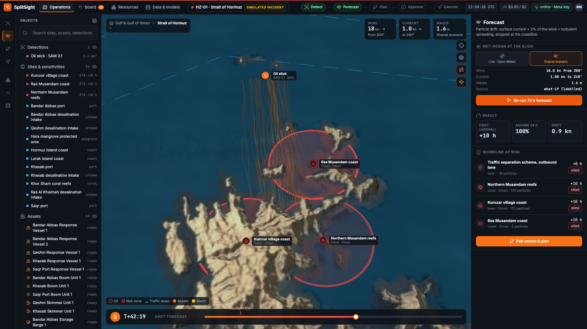
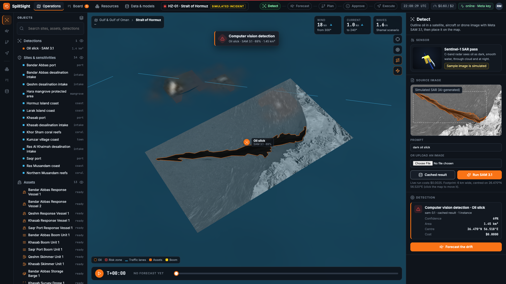
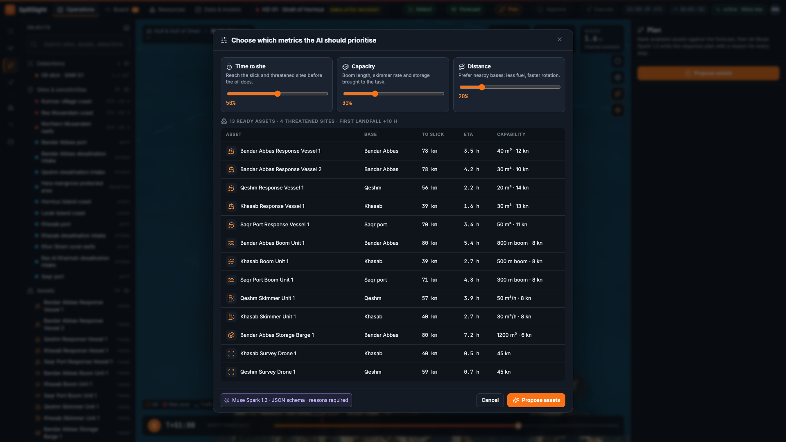
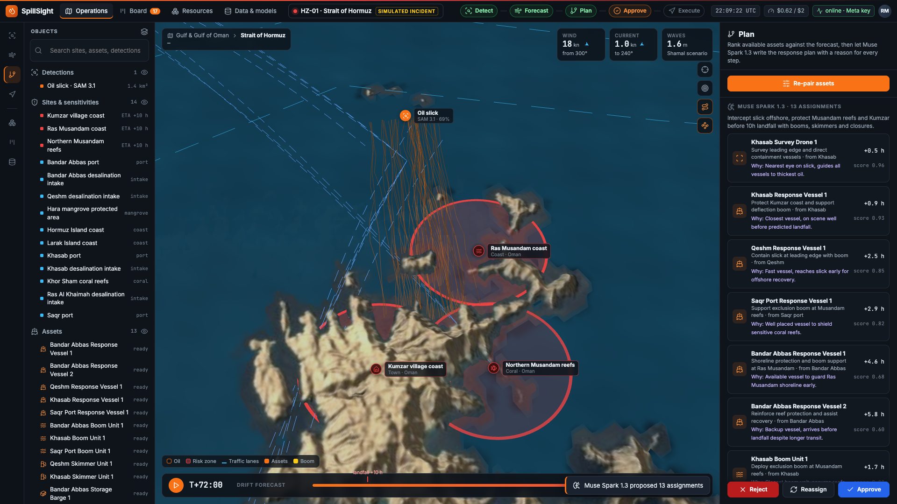
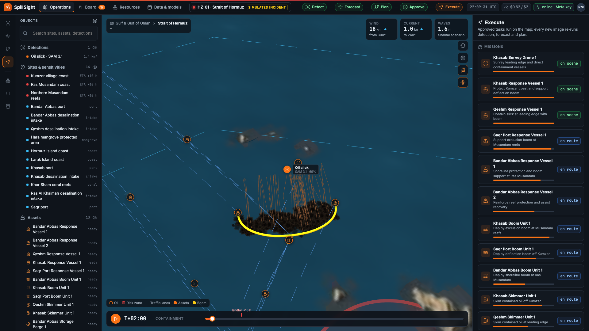
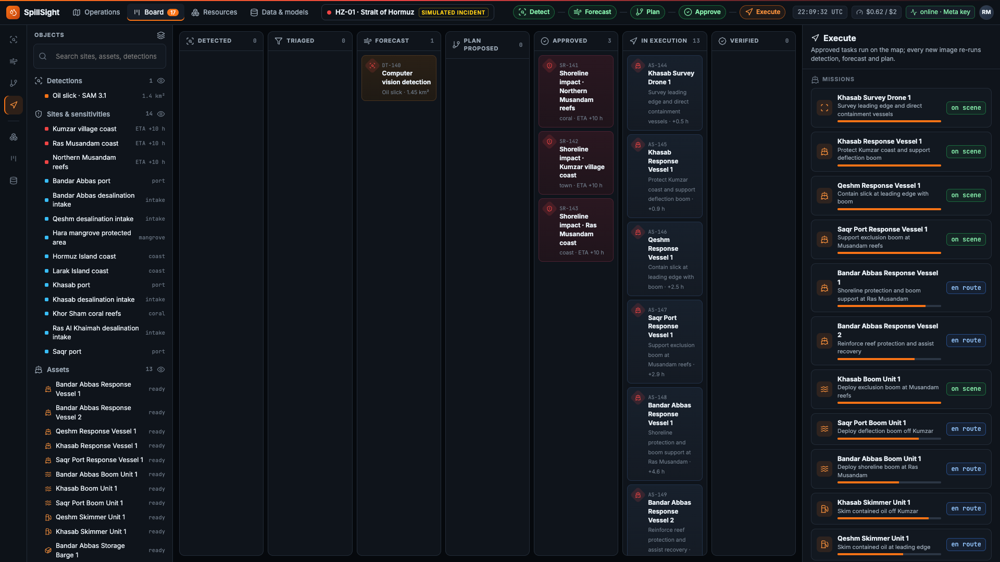
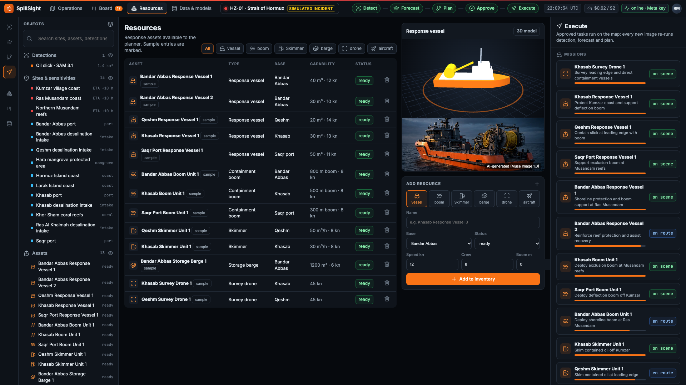
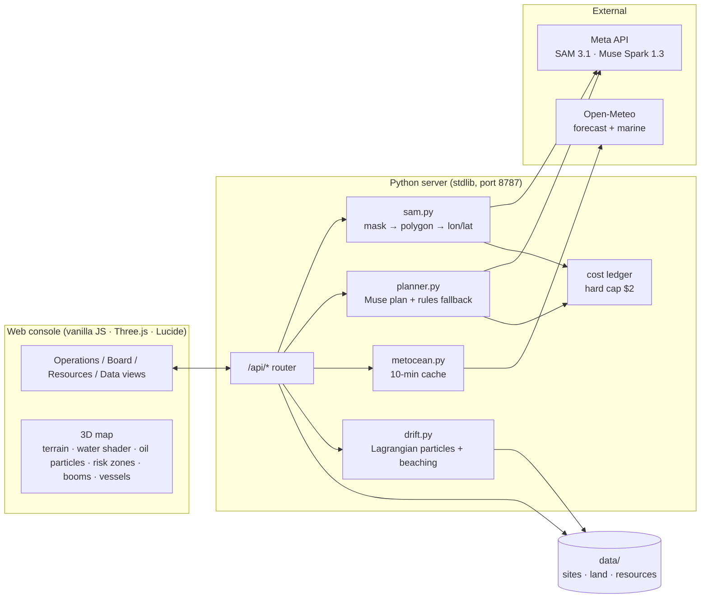
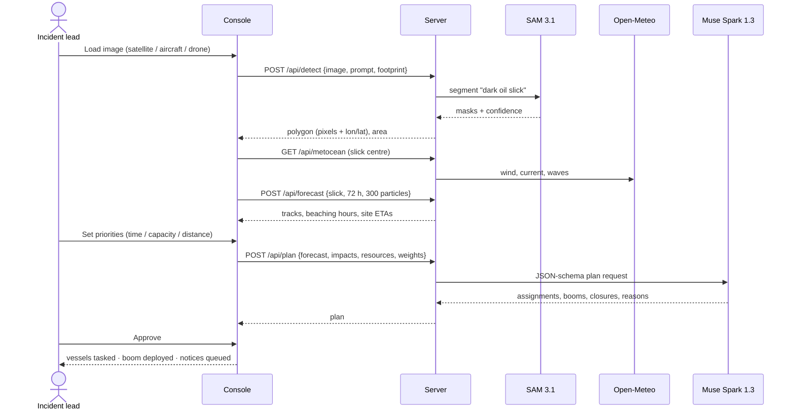

# SpillSight — AI oil-spill response for the Strait of Hormuz

SpillSight is an operations console that takes a responder from **"there is oil in this image"** to **"these boats, booms and closures, approved"** in a few minutes. It runs on a live 3D map of the Strait of Hormuz and uses Meta's models at the two points where people lose the most time: reading the imagery and writing the plan.

Built solo for the **Meta Global AI Developer Hackathon** (Cerebral Valley, indie track).



> **Scenario note:** the incident (HZ-01) is **simulated**. The sample radar image is AI-generated, all resources are sample data, and site coordinates are approximate. The pipeline itself runs for real: SAM 3.1 segmentation, live Open-Meteo wind and currents, the particle drift model and the Muse Spark 1.3 plan.

---

## What it does

| Step | What happens | Engine |
|---|---|---|
| **1. Detect** | Upload a satellite, aircraft or drone image (or use the sample Sentinel-1-style image). SAM 3.1 outlines the oil, and the outline is placed on the map at the image footprint. | **Meta SAM 3.1** (`/v1/responses`, text prompt such as `dark oil slick`) |
| **2. Forecast** | 300 particles drift for 72 h: surface current + 3% of the wind + turbulent spreading. They stop when they hit the coastline. The console shows each threatened site's ETA, red risk zones and trajectories. | Python drift model, **live Open-Meteo** wind/current/waves, Natural Earth coastline |
| **3. Pair assets** | You choose what the AI should prioritise (time to site, capacity, distance). Every ready asset is listed with its distance and ETA to the slick. | Console + server scoring |
| **4. Plan** | Muse Spark writes the plan as strict JSON, with a plain-language reason for every line: assignments, booms (containment / deflection / exclusion, with angles), closures timed before oil arrives, and advisories. | **Meta Muse Spark 1.3** (`json_schema`, strict) with a deterministic rules fallback |
| **5. Approve & execute** | The incident lead approves, rejects or reassigns. Vessels sail from their bases, a U-boom closes around the slick, closure notices are queued, and every item moves across the board. | 3D map + board |
| **Resources** | A live inventory of vessels, booms, skimmers, storage, drones and aircraft. You can add or remove assets, each with a 3D hardware model and a product image. | `/api/resources`, Three.js models, Muse Image 1.0 |

<table>
<tr><td></td><td></td></tr>
<tr><td><b>Detect</b>: SAM 3.1 outline, draped on the map at the image footprint</td><td><b>Pair assets</b>: choose what the AI should prioritise</td></tr>
<tr><td></td><td></td></tr>
<tr><td><b>Plan</b>: Muse Spark 1.3 assignments, each with a reason</td><td><b>Execute</b>: U-boom closes around the slick, crews en route</td></tr>
<tr><td></td><td></td></tr>
<tr><td><b>Board</b>: every detection, threatened site and assignment, from Detected to Verified</td><td><b>Resources</b>: inventory, add-asset form, 3D hardware model</td></tr>
</table>

---

## Architecture





**Coordinates.** Everything is stored as `[lon, lat]`. The map is a Web-Mercator crop at zoom 11, centred on 56.30°E 26.50°N, 280 × 158 km, converted to kilometres for Three.js (see [`CONTRACT.md`](CONTRACT.md)).

**WebGL1-safe rendering.** There are no shader derivatives, no instancing and no 32-bit indices. Hill-shading is baked into the texture, and oil is drawn as many soft dark patches with a faint iridescent rim, so it works on older GPUs and in headless Chrome.

---

## Run it

```bash
git clone https://github.com/<you>/spillsight && cd spillsight
echo "META_API_KEY=your_key" > ../.env      # optional: without a key, detection uses the cached sample and planning uses the rules engine
python3 server/app.py                        # → http://127.0.0.1:8787
```

You need Python 3.10+; there are no pip installs. To rebuild the terrain, run `python3 tools/build_terrain.py` (numpy and Pillow; it downloads EOX and AWS tiles). To regenerate the screenshots, run `node tools/screenshots.mjs http://127.0.0.1:8787/ docs/img` (needs puppeteer-core and Chrome).

### API

| Endpoint | Purpose |
|---|---|
| `GET /api/health` | key present, spend vs cap |
| `GET /api/sites` | ports, desalination intakes, mangroves, reefs, coast, traffic lanes |
| `GET/POST/DELETE /api/resources` | asset inventory |
| `GET /api/metocean?lon=&lat=` | live wind / current / waves (Open-Meteo), defaults if offline |
| `POST /api/detect` · `POST /api/detect/sample` | SAM 3.1 segmentation, georeferenced |
| `POST /api/forecast` | 72 h particle drift, beaching, site ETAs |
| `POST /api/plan` | Muse Spark 1.3 plan (cached per input), rules fallback |
| `GET /api/ledger` | every paid call with its cost |

Full shapes: [`CONTRACT.md`](CONTRACT.md) and [`server/README_API.md`](server/README_API.md).

---

## Honest limits

- **The drift model is deliberately simple.** It uses one uniform current/wind field at the slick, 3% windage, K = 3 m²/s spreading, no weathering chemistry and no tides. A production system would use OpenDrift or GNOME with gridded CMEMS/HYCOM currents. It has not been validated against a real spill (no hindcast yet).
- **The weather "scenario" is labelled.** Live Open-Meteo conditions are often calm, and then the slick never reaches shore within 72 h. The console therefore offers a labelled **Shamal scenario** (18 kn from 300°, 1.0 kn current to 240°) next to the live feed.
- **SAM 3.1 needs the right prompt.** `dark oil slick` works on radar-style imagery. Generic prompts such as `oil slick` often return nothing on real photos, and point prompts on the radar sample selected the whole sea.
- **Site positions are approximate**, and the coastline (Natural Earth 10m) is coarse around the Musandam fjords.
- **The Muse Spark plan is decision support, not a decision.** A person approves every plan, and the rules engine produces a plan without the API.
- **The region is politically sensitive.** The tool is neutral about the cause of any incident and covers every coast in the strait the same way.

## Data and credits

- Satellite basemap: **Sentinel-2 cloudless 2016 by EOX IT Services GmbH** (contains modified Copernicus Sentinel data), CC BY 4.0
- Elevation: **AWS Terrain Tiles** (Mapzen / open data)
- Coastline: **Natural Earth** 10m (public domain)
- Weather and ocean: **Open-Meteo** forecast and marine APIs (CC BY 4.0)
- Models: **Meta SAM 3.1**, **Meta Muse Spark 1.3**, **Meta Muse Image 1.0** (hardware images, labelled AI-generated)
- Libraries: **Three.js** r149 (MIT), **Lucide** icons (ISC), **meta_sam_parser** (vendored with its licence)
- Spend for everything in this repo and the demo video: about **$0.62** of a $2 cap (see `/api/ledger`).
